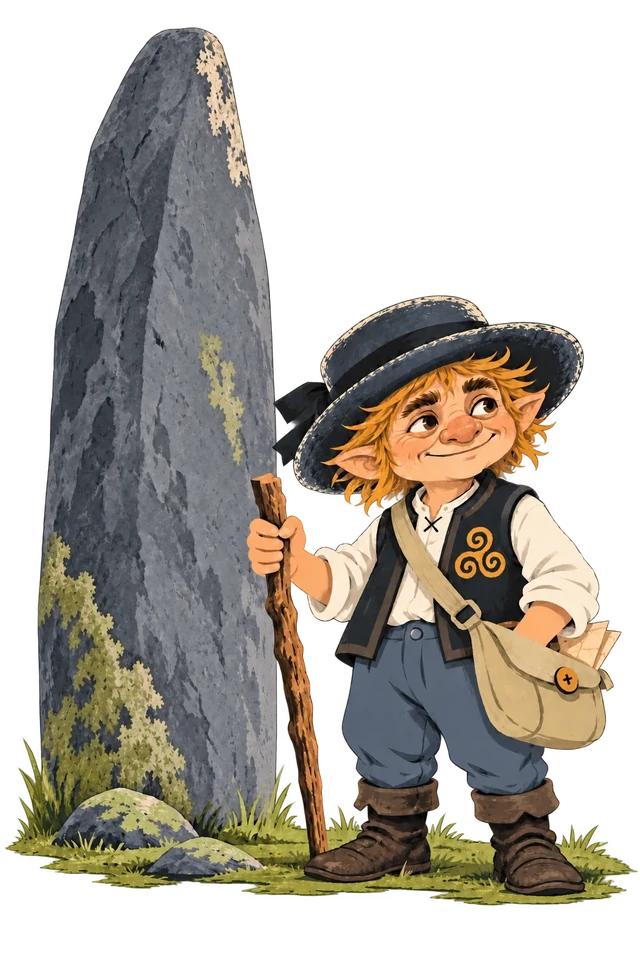

# Travelling Korrigan

Small games built on web standards. Play them in a browser, on your phone or your computer, or install them from the app stores.
**Free to play. Offline. No ads.**

Travelling Korrigan is an independent label run by [Horacio Gonzalez](https://github.com/LostInBrittany), a Spaniard lost in Brittany, France. A korrigan is a small creature from Breton folklore. This one travels.

## Why

I looked for offline games to play on flights. Something to empty my head, tired, with no connection. On my Android phone, I kept finding games full of ads, even small ones whose developers probably earn very little from them. So I decided to make the games I wanted to play myself, and to let anyone play them freely.

I make them with the help of Claude Code.

## The promise

Every game follows the same rules:

- It works fully offline.
- No ads of any kind.
- No tracking, no analytics.
- Free, with no in-app purchases.
- No dark patterns: no timers pushing you, no streaks, no notifications. If a game has lives, they are part of the game, never something you wait for or buy.

I make these games for my own pleasure first. If they give you a quiet moment too, good.

## Games

**Menhir Mahjong** (in development). A calm mahjong solitaire with a Breton identity, its tiles inspired by ermines, triskels, shells, menhirs, dolmens and lighthouses. Every deal can be solved, undo is unlimited, shuffling is free, and there is no timer.
